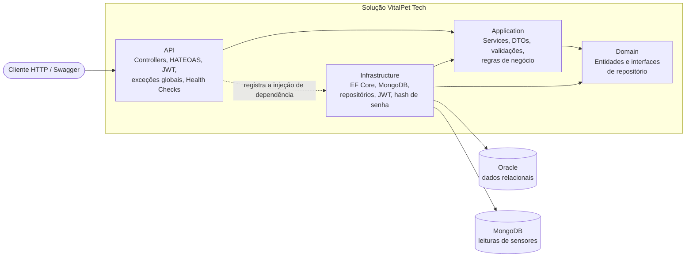

# 🐾 VitalPet Tech API

## 📖 Descrição do Projeto

A VitalPet Tech API é um sistema back-end em C# com .NET 8 para gerenciar a saúde e o monitoramento de pets. Ela permite o cadastro de tutores e seus animais, o registro do histórico médico (eventos clínicos como vacinas e consultas), a emissão de alertas de saúde e a recepção de leituras de sensores IoT (batimento cardíaco, temperatura e localização do animal).

Nesta versão final, o projeto consolida todas as sprints:

* **Clean Architecture** em 4 camadas (Domain, Application, Infrastructure e API), com Repository, SOLID e injeção de dependência.
* **API RESTful** com paginação, ordenação, filtros e **HATEOAS** nos endpoints de consulta.
* **Autenticação e autorização com JWT**, com perfis `Admin` e `Usuario`.
* **Persistência híbrida**: Oracle (EF Core com migrações) para os dados relacionais e **MongoDB** para as leituras dos sensores.
* **Tratamento global de exceções** com respostas no padrão `ProblemDetails`.
* **Observabilidade**: Health Checks (Oracle e MongoDB), logging estruturado com Serilog e tracing/métricas com OpenTelemetry.
* **Testes automatizados** (unitários e de integração) no padrão AAA.

## 👥 Integrantes

* Gabriel Müller — RM561995
* Jonas Santos — RM563234
* Pedro Ferreira — RM565824

## 🏛️ Arquitetura

O projeto segue a Clean Architecture. As dependências sempre apontam para dentro: a camada de domínio não conhece nenhuma das outras.


<details>
<summary>Diagrama em Mermaid</summary>



</details>

| Camada | Responsabilidade |
|---|---|
| **Domain** | Entidades (`Tutor`, `Pet`, `EventoClinico`, `Alerta`, `LeituraSensor`, `Usuario`), interfaces de repositório e tipos de paginação e filtro. Não depende de nenhum framework. |
| **Application** | Services com as regras de negócio, DTOs de entrada e saída com validações, exceções de negócio e contratos de segurança. |
| **Infrastructure** | `ApplicationContext` (EF Core + Oracle), mapeamento Fluent API, migrações, repositórios concretos, repositório MongoDB, hash de senha (PBKDF2) e geração do JWT. |
| **API** | Controllers, HATEOAS, autenticação/autorização, handler global de exceções, Swagger, Serilog, OpenTelemetry e Health Checks. |

**Princípios aplicados:** inversão de dependência (os Services dependem de interfaces), responsabilidade única (Controller só orquestra, Service decide, Repository persiste) e DRY (`BaseRepository` e mapeamentos centralizados).

## 🛠️ Instruções de Instalação e Execução

### Pré-requisitos

* [.NET SDK 8.0](https://dotnet.microsoft.com/download)
* Acesso a um banco **Oracle** (usado pela FIAP)
* **Docker Desktop** iniciado, com suporte a contêineres Linux, para executar o MongoDB local; alternativamente, uma instância MongoDB acessível
* **PowerShell** para os comandos de configuração abaixo
* Uma IDE de sua preferência (Visual Studio, VS Code, Rider), opcional para execução pelo terminal
* Ferramenta do EF Core: `dotnet tool install --global dotnet-ef --version 8.0.10`

### Passo a passo

1. Clone o repositório e entre na pasta que contém `VitalPet Tech.sln`:
   ```bash
   git clone https://github.com/glMuller/VitalPet_Tech.git
   cd VitalPet_Tech
   ```
2. Inicie o **Docker Desktop** e crie o MongoDB local na primeira execução:
   ```powershell
   docker run --name vitalpet-mongo --detach --publish 127.0.0.1:27017:27017 --volume vitalpet-mongo-data:/data/db --restart unless-stopped mongo:7
   docker ps --filter "name=vitalpet-mongo"
   ```
   O contêiner expõe o MongoDB somente na máquina local, na porta `27017`. O volume `vitalpet-mongo-data` preserva os dados entre reinicializações. Esse exemplo local não configura autenticação e não deve ser exposto publicamente.

   Se o contêiner `vitalpet-mongo` já existir, use `docker start vitalpet-mongo` em vez de executar `docker run` novamente. Para conferir a inicialização: `docker logs --tail 30 vitalpet-mongo`.

   Cada avaliador executa seu próprio contêiner. Não é necessário que o computador do autor esteja ligado. O banco MongoDB local começa vazio; o banco e a coleção são criados ao inserir a primeira leitura. Com outra instância MongoDB, substitua a connection string do próximo passo e dispense o contêiner local.
3. Configure os segredos **fora do repositório**, com o `user-secrets` (rode na raiz da solução):
   ```powershell
   # Informe uma conexão Oracle completa e válida, com usuário e senha.
   dotnet user-secrets set "ConnectionStrings:OracleConnection" "SUA_CONNECTION_STRING_ORACLE" --project "VitalPet Tech.API"

   # MongoDB do contêiner local iniciado no passo anterior
   dotnet user-secrets set "Mongo:ConnectionString" "mongodb://localhost:27017" --project "VitalPet Tech.API"

   # Chave do JWT (mínimo 32 caracteres) - gera uma aleatória
   $b = New-Object byte[] 48
   [Security.Cryptography.RandomNumberGenerator]::Create().GetBytes($b)
   dotnet user-secrets set "Jwt:Key" ([Convert]::ToBase64String($b)) --project "VitalPet Tech.API"
   ```
   O projeto já possui `UserSecretsId`; não é necessário inicializá-lo novamente. Os segredos são locais ao usuário e **não acompanham o clone do GitHub**. O avaliador deve configurar suas credenciais Oracle ou recebê-las por um canal separado. Não publique senhas nem a chave JWT no repositório.

   O `appsettings.json` guarda configurações não sensíveis, incluindo o banco Mongo `vitalpet`, emissor e audiência do JWT. Uma conexão Oracle de exemplo tem o formato `Data Source=SERVIDOR:1521/NOME_DO_SERVICO;User Id=USUARIO;Password=SENHA;`; use o formato SID ou service name fornecido pelo seu ambiente Oracle.
4. Restaure os pacotes e crie as tabelas no Oracle com as migrações. Use um esquema destinado ao projeto, com permissão para criar tabelas. A fábrica de migrações lê `VITALPET_ORACLE_CONNECTION`; informe nela **a mesma conexão Oracle** configurada no passo anterior:
   ```powershell
   dotnet restore "VitalPet Tech.sln"
   $env:VITALPET_ORACLE_CONNECTION = "SUA_CONNECTION_STRING_ORACLE"
   dotnet ef database update --project VitalPetTech.Infrastructure --startup-project "VitalPet Tech.API" --context VitalPetTech.Infrastructure.Data.ApplicationContext
   Remove-Item Env:VITALPET_ORACLE_CONNECTION
   ```
   A variável é removida após o comando; a API continua usando a conexão configurada nos user-secrets. A configuração do provedor usa compatibilidade SQL Oracle 19 para evitar literais booleanos incompatíveis com versões anteriores ao Oracle 23c.
5. Execute a aplicação com o perfil HTTP:
   ```bash
   dotnet run --project "VitalPet Tech.API" --launch-profile http
   ```
6. Acesse o [Swagger em HTTP](http://localhost:5240/swagger/index.html) e consulte o [Health Check](http://localhost:5240/health). O resultado esperado do Health Check é HTTP `200`, com Oracle e MongoDB em `Healthy`.

   No Rider, selecione o perfil `http` para usar apenas `http://localhost:5240`. O perfil `https` disponibiliza a mesma API em `https://localhost:7143` e `http://localhost:5240`; o HTTPS utiliza um certificado de desenvolvimento que precisa ser confiável no computador. O Swagger é habilitado somente em `Development`, ambiente já definido pelos perfis locais.

### Problemas comuns ao iniciar

| Sintoma | Verificação |
|---|---|
| Porta `5240` ocupada / `address already in use` | Encerre a execução anterior da API antes de iniciá-la novamente pelo Rider ou terminal. |
| Docker não conecta ao Engine | Inicie o Docker Desktop e aguarde o Engine ficar em execução. |
| Nome `vitalpet-mongo` já está em uso | Reutilize o contêiner existente com `docker start vitalpet-mongo`. |
| `/health` retorna `503` | Consulte qual entrada está `Unhealthy`. Para MongoDB, confira o contêiner e a connection string; para Oracle, confira conectividade, credenciais e disponibilidade do servidor. |
| Registro retorna `500` | Consulte o log local. Confirme também que as migrações foram aplicadas no mesmo esquema Oracle usado pela API. |
| Configuração de JWT ou Mongo ausente | Configure os user-secrets para o projeto `VitalPet Tech.API`, no mesmo usuário que executa a aplicação. |

### Primeiro acesso (autenticação)

1. Registre um usuário em `POST /api/Auth/registrar`. **O primeiro usuário cadastrado recebe o perfil `Admin`**, e os seguintes recebem `Usuario`.
2. Faça login em `POST /api/Auth/login` e copie o `accessToken`.
3. No Swagger, clique em **Authorize** e cole apenas o token. Em chamadas diretas, envie o header `Authorization: Bearer {token}`.

Exemplo de corpo para registro (substitua os dados e escolha sua própria senha):

```json
{
  "nome": "Avaliador",
  "email": "avaliador@example.com",
  "senha": "SenhaDeExemplo123!"
}
```

No login, envie apenas `email` e `senha`. Registro e login são públicos, mesmo que o Swagger mostre o cadeado devido à definição global de segurança. O primeiro usuário é determinado pelo conteúdo do **esquema Oracle**, e não pelo MongoDB ou pelo computador; em um esquema já populado, o novo usuário pode receber `Usuario`.

### Roteiro de verificação funcional

1. Confirme `/health` com HTTP `200`.
2. Registre um usuário (`201`), faça login (`200`) e autorize o Swagger com o token.
3. Cadastre um Tutor (`201`) e use o `id` retornado para cadastrar um Pet em `idTutor` (`201`).
4. Use o `id` do Pet em `idPet` para cadastrar EventoClinico, Alerta e LeituraSensor (`201`). Envie os nomes dos enums mostrados no Swagger, como `Batimento` e `Critico`.
5. Consulte os registros e as listas com filtros/paginação (`200`). Os GETs incluem links HATEOAS; `next` e `prev` aparecem quando há páginas correspondentes.
6. Atualize os recursos relacionais com PUT (`204`, sem corpo). O endpoint de leituras oferece inclusão e consulta.
7. Para excluir dados de teste, use uma conta Admin e remova os recursos relacionais com DELETE (`204`, sem corpo). Uma conta `Usuario` recebe `403` nessa operação.

As leituras MongoDB não são removidas automaticamente ao excluir um Pet/Tutor do Oracle. Considere essa retenção de histórico ao preparar os dados de demonstração.

| Endpoint | Acesso |
|---|---|
| `/health`, `/api/Auth/*` | Público |
| Demais endpoints de consulta, criação e atualização | Qualquer usuário autenticado |
| `DELETE` em qualquer recurso | Somente perfil `Admin` |

## 📌 Documentação das Rotas

A especificação completa está em [`docs/swagger.json`](docs/swagger.json) (OpenAPI), e também no Swagger da aplicação. Abaixo estão os principais endpoints.

### 📄 Paginação, ordenação e filtros

Todas as listagens (`GET` na raiz do recurso) aceitam:

| Parâmetro | Descrição |
|---|---|
| `page` | Página (padrão `1`) |
| `pageSize` | Itens por página (padrão `10`, máximo `50`) |
| `orderBy` | Campo de ordenação (lista fixa por recurso, valores inválidos usam o padrão) |
| `descending` | `true` para ordem decrescente |

A resposta traz `items`, `page`, `pageSize`, `totalCount`, `totalPages` e `links` (`self`, `first`, `last`, `prev`, `next`, `create`). Cada item também traz seus próprios `links` (HATEOAS).

### 🔐 Autenticação (/api/Auth)

* `POST /api/Auth/registrar`: Registra um novo usuário.
* `POST /api/Auth/login`: Autentica e devolve o token JWT.

### 👤 Tutores (/api/Tutor)

* `GET /api/Tutor`: Lista tutores. Filtro: `nome`. Ordenação: `nome`, `id`.
* `GET /api/Tutor/{id}`: Retorna um tutor e o resumo dos seus pets.
* `POST /api/Tutor`: Cadastra um tutor.
* `PUT /api/Tutor/{id}`: Atualiza um tutor.
* `DELETE /api/Tutor/{id}`: Remove um tutor (Admin).

### 🐾 Pets (/api/Pet)

* `GET /api/Pet`: Lista pets. Filtros: `especie`, `tutorId`. Ordenação: `nome`, `especie`, `peso`, `dataNascimento`, `id`.
* `GET /api/Pet/{id}`: Retorna um pet.
* `POST /api/Pet`: Cadastra um pet (o tutor precisa existir).
* `PUT /api/Pet/{id}`: Atualiza um pet.
* `DELETE /api/Pet/{id}`: Remove um pet (Admin).

### 🏥 Eventos Clínicos (/api/EventoClinico)

* `GET /api/EventoClinico`: Lista eventos, do mais recente para o mais antigo por padrão. Filtros: `petId`, `tipo`. Ordenação: `data`, `tipo`, `clinica`, `id`.
* `GET /api/EventoClinico/{id}`: Retorna um evento.
* `POST /api/EventoClinico`: Adiciona um evento (o pet precisa existir).
* `PUT /api/EventoClinico/{id}`: Atualiza um evento.
* `DELETE /api/EventoClinico/{id}`: Remove um evento (Admin).

### 🚨 Alertas (/api/Alerta)

* `GET /api/Alerta`: Lista alertas, do mais recente para o mais antigo por padrão. Filtros: `petId`, `resolvido`, `severidade`, `tipoAlerta`. Use `?resolvido=false` para ver os pendentes. Ordenação: `timestamp`, `severidade`, `tipo`, `id`.
* `GET /api/Alerta/{id}`: Retorna um alerta.
* `POST /api/Alerta`: Registra um alerta (sempre nasce não resolvido).
* `PUT /api/Alerta/{id}`: Atualiza um alerta (marca como resolvido).
* `DELETE /api/Alerta/{id}`: Remove um alerta (Admin).

### 📡 Leituras de Sensores (/api/LeituraSensor) — MongoDB

* `GET /api/LeituraSensor`: Lista leituras, da mais recente para a mais antiga por padrão. Filtros: `petId`, `tipo`, `de`, `ate`. Ordenação: `timestamp`, `valor`, `tipo`.
* `GET /api/LeituraSensor/{id}`: Retorna uma leitura.
* `POST /api/LeituraSensor`: Registra uma leitura (o pet precisa existir). Batimento e temperatura exigem `valor`, e localização exige `latitude` e `longitude`.

> As leituras ficam no MongoDB (volume alto, sem relacionamentos). Os alertas ficam no Oracle.

### ⚠️ Padrão de erros

| Status | Significado |
|---|---|
| `400` | Erro de validação dos dados enviados |
| `401` | Sem token, token inválido ou credenciais incorretas |
| `403` | Usuário autenticado sem permissão (ex: `DELETE` sem ser Admin) |
| `404` | Recurso não encontrado |
| `422` | Regra de negócio violada (ex: pet para um tutor inexistente) |
| `500` | Erro interno, sem detalhes expostos |

As exceções de negócio e falhas internas tratadas pelo handler global geram `ProblemDetails`, com `status`, `title`, `instance` e `traceId`; `detail` descreve erros de negócio e não expõe detalhes internos em `500`. Erros automáticos de validação usam `ValidationProblemDetails`, incluindo o campo `errors`. Respostas `401`/`403` geradas pelo middleware de autenticação/autorização podem vir sem corpo; o `401` de credenciais inválidas no login é tratado pelo handler global.

## 📊 Monitoramento e Observabilidade

### Health Check

```
GET /health
```

Valida a conectividade com o **Oracle** e com o **MongoDB**:

```json
{
  "status": "Healthy",
  "entries": {
    "oracle-database": { "status": "Healthy", "tags": ["db", "oracle"] },
    "mongodb": { "status": "Healthy", "tags": ["db", "mongodb"] }
  }
}
```

Se algum banco estiver indisponível, o `status` passa a `Unhealthy` e a resposta é `503`. O endpoint é público, para ser consumido por orquestradores (Kubernetes, Docker, load balancers).

```bash
curl http://localhost:5240/health
```

### Logging estruturado

O **Serilog** grava no console e em arquivo (`Logs/log-{data}.txt`, com rotação diária). Cada requisição HTTP é registrada com método, rota, status e tempo de resposta. Os Services registram eventos de negócio com níveis `Information` e `Warning`, e o handler global registra falhas inesperadas como `Error`.

### Tracing e métricas

O **OpenTelemetry** instrumenta requisições ASP.NET Core e HttpClient, exportando traces e métricas para o console. A configuração atual habilita esses exportadores em todos os ambientes; não há painel externo configurado. Um exportador para outro destino pode ser configurado em `Program.cs`.

## ✅ Como Executar os Testes

```bash
dotnet test "VitalPet Tech.sln" -m:1
```

Para rodar um projeto específico ou um teste isolado:

```bash
dotnet test "VitalPetTech.Tests.Unit/VitalPetTech.Tests.Unit.csproj" -m:1
dotnet test "VitalPetTech.Tests.Integration/VitalPetTech.Tests.Integration.csproj" -m:1
dotnet test "VitalPet Tech.sln" -m:1 --filter "NomeDoTeste"
```

| Projeto | O que cobre | Como isola dependências |
|---|---|---|
| `VitalPetTech.Tests.Unit` | Domain, Application (Services e DTOs), alguns repositórios EF e compatibilidade do SQL Oracle gerado | **Moq** nos repositórios e no logger, **EF Core InMemory** em testes de repositório e geração de SQL sem conexão |
| `VitalPetTech.Tests.Integration` | Fluxo HTTP completo via `WebApplicationFactory`: autenticação, autorização por perfil, paginação, filtros, HATEOAS e erros | Oracle trocado por InMemory e MongoDB por um repositório em memória |

**Convenções:** padrão **AAA** (Arrange, Act, Assert) e nomenclatura `MetodoTestado_Cenario_ResultadoEsperado`. A maioria dos testes HTTP compartilha uma **Collection Fixture** (`CustomWebApplicationFactory`); o teste de registro/login cria sua própria factory para validar o primeiro usuário em um banco isolado. Os testes automatizados não precisam de Oracle, MongoDB nem de segredos pessoais configurados. Hash de senha e JWT são exercitados pelo fluxo de integração; não há testes unitários dedicados para todos os componentes de segurança.

Para coletar cobertura com o coletor já referenciado nos projetos de teste:

```bash
dotnet test "VitalPet Tech.sln" -m:1 --collect:"XPlat Code Coverage" --results-directory TestResults
```

Os relatórios `coverage.cobertura.xml` ficam em subpastas de `TestResults`. Os testes com InMemory e repositório simulado validam o fluxo da API, mas não substituem a verificação de migrações, conectividade e consultas nos bancos reais. Para isso, siga também o roteiro funcional acima.

### Conferência da entrega

Antes de enviar o link do GitHub, confirme que o README, `docs/swagger.json`, as migrações, as correções e os testes novos estão incluídos no commit e no push. Credenciais e user-secrets devem permanecer fora do repositório. Valide os passos de instalação em um clone limpo, com as próprias configurações de banco do avaliador.

## 🗂️ Estrutura da Solução

```
VitalPet Tech.sln
├── VitalPetTech.Domain/           Entidades, interfaces e tipos de filtro
├── VitalPetTech.Application/      Services, DTOs, HATEOAS (modelo) e exceções
├── VitalPetTech.Infrastructure/   EF Core, MongoDB, repositórios, migrações e segurança
├── VitalPet Tech.API/             Controllers, Program.cs, Swagger e Health Checks
├── VitalPetTech.Tests.Unit/       Testes unitários
├── VitalPetTech.Tests.Integration/ Testes de integração
└── docs/                          swagger.json exportado
```
